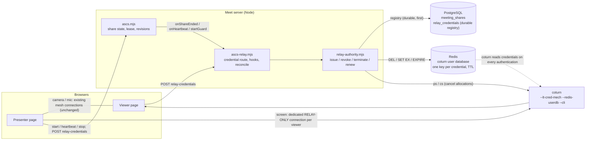

# ASCS-M1.2 — Relay-enforced screen sharing (Option B)

Branch `feature/qorlla-ascs-v1-v2`, continuing from `f6d3293` (M1.1, preserved). PR #8 stays a **Draft**. Nothing here is pushed, merged, tagged or deployed; `qlaunch` was not touched.
`ASCS_ENABLED` is **off by default**, and so is the new `ASCS_RELAY_ENABLED`.

## 1. Verdict

* **GO to continue development** (M1.3: hardening and certification). The central question was whether credentials on coturn can be revoked **durably** so that a client holding them cannot simply reconnect. **They can**, and this was demonstrated (section 4), so the SFU migration proposal that was the fallback is not needed now (a short "when to move to an SFU" note is in section 9).
* **NO-GO for production.** The relay-enforced channel is an **intermediate** security improvement, **not equivalent to SFU-enforced media authorization**. A modified client can still send screen content through its ordinary camera connection (demonstrated, section 7). Open items are in section 8.

What changed compared with M1.1: a presenter whose page ignores every "stop presenting" message used to keep delivering the screen (60 frames per 4 s measured). With the relay-enforced channel the same tampered page delivered **0 screen frames in 5 s** after the revoke, could not obtain fresh credentials (409) and could not start a new share (403), while its camera connection kept working.

## 2. Architecture



**Two kinds of connection.** The existing camera and microphone connections (the mesh) are untouched. The screen travels on a **dedicated** `RTCPeerConnection` per viewer with `iceTransportPolicy: "relay"`, using TURN credentials that exist only for one meeting + participant + share + role.

### Start, run, revoke

```mermaid
sequenceDiagram
  autonumber
  participant P as Presenter page
  participant M as Meet (ascs + relay)
  participant D as PostgreSQL
  participant R as Redis
  participant T as coturn
  participant V as Viewer page
  P->>M: POST /shares
  M->>M: startGuard: is the relay controllable? (else 503, fail closed)
  M-->>P: share (active, lease)
  P->>M: POST /shares/:id/relay-credentials
  M->>M: role = presenter (decided by the SERVER: the share's owner)
  M->>D: INSERT relay_credentials (no secret stored)
  M->>R: SET key = MD5(user:realm:password) EX ttl
  M->>M: re-check the share is still live (closes the race with a revoke)
  M-->>P: iceServers (relay-only, short-lived)
  P->>V: share-offer (signalling)
  V->>M: POST /shares/:id/relay-credentials (server confirms who presents first)
  M-->>V: viewer credentials
  P-->>T: allocate + media (relay)
  T-->>V: media
  Note over P,M: heartbeat renews the lease AND extends the credentials
  M->>D: share revoked / expired / Shield denied (recorded durably FIRST)
  M->>R: DEL the credentials  (nothing can authenticate again)
  M->>T: ps / cs  (cancel the live allocations)
  T--xV: forwarding stops
  P->>M: new credentials? -> 409 (share not active); new share? -> 403
```

### Why the order matters (measured, section 4)
Deleting a credential does **not** stop an allocation that already runs; cancelling an allocation does **not** stop a client that still holds a valid credential. Revocation is therefore a fixed sequence, each step idempotent: **(1)** record it durably, **(2)** delete the credentials (no new allocation, no ICE restart, no reconnect), **(3)** cancel the live allocations through the coturn admin CLI, **(4)** verify none remain, then stamp `terminated_at`. If step 2 or 3 cannot be done, the row stays *pending termination* and the reconciler finishes it on every boot and sweep.

## 3. How each requirement is met

| Requirement | Mechanism | Evidence |
|---|---|---|
| 1. Dedicated, individually revocable credentials (meeting, participant, share) | `relay_credentials` registry + Redis user-database keys; opaque random username, password never stored; the server decides the role; max 6 live credentials per person per share | PoC C1; relay e2e S0, S1 |
| 2. Relay-only screen transport; camera/mic unchanged | one dedicated relay-only connection per viewer; the mesh is not touched while sharing (no `replaceTrack`, no second audio slot) | G1: host has a camera stream **and** a separate 416 px screen stream on a `relay` pair; camera rate kept |
| 3. Revoke on host stop, Shield denial, lease expiry | `onShareEnded` after every commit: host revoke (S1, G2/G3), participant denied (S2), lease expiry (S3), meeting end, handoff | relay e2e S1–S3; Shield test below |
| 4. No reconnection without fresh authorization | revoked credentials get 401; ICE restart and a new allocation are refused; `relay-credentials` for a dead share returns 409; each reconnect fetches fresh credentials | PoC C2; S1; G3 |
| 5. Fail closed | `issue()` needs Redis **and** the CLI to answer; the start guard returns 503; an incomplete relay configuration refuses to start Meet | PoC R3; S0, S4 |
| 6. Audit and recovery | revocation recorded durably first; `reconcile()` on boot and every sweep; `share.*` audit rows from M1.1 | PoC R1/R2/R4; S5 |

## 4. The experiment matrix (coturn's actual behaviour, not assumed)

Real Chromium, real WebRTC through a real coturn 4.17 in user-database mode. Evidence file: `docs/evidence/m12-relay-poc.json` (46 of 46 checks).

| Action on a running share | Existing media | New allocation / reconnect |
|---|---|---|
| **Delete the credential only** | **continues** (60 frames in 4 s) | refused: 401, no relay candidate |
| **Cancel the allocation only** | stops | **resumes** after an ICE restart with the same credential |
| **Delete + cancel (the design)** | stops | **refused**: ICE restart does not bring it back (25 s); 401 for both presenter and viewer credentials |

Further PoC results: revoking one share leaves another untouched; the camera pair kept its rate (31/28/28 frames per 2 s before, 31/31/28/22 after the share was revoked) on separate coturn allocations; a credential revoked **before a coturn restart is still refused after it**; a revocation recorded while the TURN control service was down was **finished by a brand-new instance** that shared only the database; issuing is denied when Redis or the CLI is down, and nothing is written; an allocation **outlives** its credential's TTL (31 frames in 2 s after expiry) until reconcile terminates it.

## 5. What was implemented

| File | Role |
|---|---|
| `server/relay-authority.mjs` | issue / renew / revoke (share, participant, meeting) / terminate / reconcile; fail closed; durable-first |
| `server/resp-client.mjs`, `server/turn-cli.mjs` | dependency-free Redis client; coturn admin-CLI client (adapted from the voice engine) |
| `server/ascs-relay.mjs` | credential route, share-ended / heartbeat / start-guard hooks, boot + sweep reconcile, Shield participant hook |
| `server/ascs.mjs`, `host-controls.mjs`, `shield-client.mjs`, `index.js` | generic hooks (`onShareEnded`, `onHeartbeat`, `startGuard`); `/tools` reports `relay`; Shield revocation also revokes the person's relay credentials; the signalling relay accepts `share-*` messages |
| `public/app.js` | the dedicated share channel: presenter opens one relay-only connection per viewer with server-issued credentials; viewers accept an offer only after the **server** says who presents; late joiners get a connection; reconnects fetch fresh credentials; the tile shows the screen and returns to the camera |
| `sql/v4_24_relay_credentials.sql` | the durable registry (idempotent; rollback `DROP TABLE relay_credentials`) |
| `tests/poc/relay-up.sh`, `relay-revocation.poc.mjs` | disposable coturn + Redis, and the proof of concept |
| `tests/e2e/ascs-relay.e2e.mjs` | real Meet + real coturn, scenarios S0–S7 |
| `tests/e2e/ascs-browser.e2e.mjs` | section G: the real pages; section F/T corrected to count only the screen stream |

Configuration (all required when `ASCS_RELAY_ENABLED=true`, otherwise **Meet refuses to start**): `RELAY_REDIS_HOST/PORT[/PASSWORD]`, `RELAY_CLI_HOST/PORT/PASSWORD`, `RELAY_REALM`, `RELAY_TURN_URLS`, optional `RELAY_CREDENTIAL_TTL_SECONDS` (default 300).

## 6. Acceptance table

| Scenario | Result |
|---|---|
| Host stops presenting → screen relay stops forwarding | **Pass** — S1 (media stops, coturn lists no allocation), G2, G3 |
| Revoked credential reused → connection denied | **Pass** — S1, PoC C2 (401) |
| ICE restart after revocation → reconnection denied | **Pass** — S1, PoC C2 (25 s) |
| New TURN allocation attempted → denied | **Pass** — S1, PoC |
| Shield revokes participant → authorization and relay terminated | **Pass** — S2 (audit path) and the real-Shield test (hook path) |
| TURN control service unavailable → new sharing denied | **Pass** — S4 (503), PoC R3 |
| Server restart → revocation state preserved | **Pass** — S5 (recorded durably, finished by the next process) |
| Normal camera/microphone | **No regression measured** — G1 (camera rate while sharing vs its own baseline; mic button) and the unchanged mesh paths in sections A–E |
| Malicious camera-path substitution | **Limitation demonstrated and documented** — S6 (section 7) |

## 7. The limitation that cannot be fixed by this design
The relay is content-agnostic. After a share is revoked, a modified client can still send screen-like content over its **ordinary camera connection** (S6: **44–46 frames in 3 s** still flowed, in two runs). TURN cannot tell what encrypted WebRTC media contains. Only an SFU that decides which publications are forwarded can close this. The existing "remove participant" action is the escalation (it ends all of that person's media).

## 8. Remaining limitations and blockers
1. Not production certified. Chromium only; one machine; Docker Desktop UDP path; no Firefox, Edge or Safari; no TURN across real networks; no load or failover testing.
2. **Mixed versions:** an older page ignores the relay and uses the legacy peer-to-peer share, which the server cannot enforce. Ship server and page together; the page reads `/tools.relay`.
3. **coturn must be hardened before any real use** (the PoC coturn is deliberately minimal): TLS (`turns:`), restrict relay peers to the relay range (`denied-peer-ip` / `allowed-peer-ip`), `user-quota`/`total-quota`, network isolation of the admin CLI and Redis (both are high-value secrets: anyone holding them can mint or cancel allocations), Redis authentication (the client supports it), secret rotation. A *viewer* credential also allows relaying generic traffic for its lifetime unless the peer range is restricted.
4. **Exposure window while the TURN control service is down:** a revocation is recorded and the credentials are deleted (so nothing can re-allocate) but an allocation that already runs keeps forwarding until the control service returns and reconcile terminates it (measured 16–45 frames per 3 s). New shares are refused meanwhile.
5. **Redis data loss:** no credential allocates (fail closed); running allocations continue until their credential's expiry in the registry, when reconcile terminates them. Clients re-authorize.
6. **Revocation latency 1–5 s** (about 1 s idle, 3–5 s under 720p load), dominated by 3–4 admin-CLI connections. A persistent CLI session would reduce it (not done).
7. **Share audio over the relay channel was not verified** (audio tracks are added to the share connection; only the picture is tested). Recording of a received share is untested.
8. Not started: transactional outbox, Portal entitlement enforcement, PostgreSQL restart and migration-rollback drills, accessibility, load, security certification.

## 9. Performance implications (measured here, extrapolations labelled)
| | direct (peer to peer) | relay (this design) |
|---|---|---|
| 720p animated content, 15 fps | 14.8 fps, 632 kbit/s | 14.2 fps, 431 kbit/s |
| round trip | ~0 ms (same machine) | 200 ms in this test (Docker Desktop's UDP proxy: **not representative**; real figure = path to the TURN server) |
| revoke → media stopped | n/a (not enforceable) | 0.97 s (S1 request), 1.3 s idle, 2.9–5.0 s under load |

* **Bandwidth (extrapolated, not measured on real content):** the presenter uploads one copy per viewer, through coturn, so with *N* viewers and a stream of *b* bit/s the presenter uploads *N·b* and coturn carries *2·N·b*. At the measured 431 kbit/s synthetic stream and 5 viewers that is about 2.2 Mbit/s up and 4.3 Mbit/s through the relay; real screen content varies (static content far less, video-like content several times more).
* **Cost per share:** one credential per participant per share (one API call, one Redis `SET`, one registry row); renewals piggyback on the heartbeat. Not separately benchmarked.
* **Why an SFU is still the better long-term shape:** presenter upload stops scaling with *N*, server-side recording becomes possible, and the camera-path limitation disappears. The mesh and the relay design are both bounded at about six participants.

## 10. When to move to an SFU instead
If the product requirement becomes "no uncooperative participant can deliver screen content by **any** media path", or meetings regularly exceed ~6 participants, or server-side recording is wanted, move to an SFU (LiveKit or mediasoup). Reusable from this work: the durable registry and reconcile pattern, the share lifecycle and revision model (`ascs.mjs`), the Shield hooks, and the test harness.

## 11. Reproduce
```
# coturn (user-database mode) + Redis: disposable containers qm12-*; the TURN port is published on the LAN address (Chromium ignores a loopback TURN server)
LAN_IP=<lan> qorlla-meet-video/tests/poc/relay-up.sh
# proof of concept (writes docs/evidence/m12-relay-poc.json)
LAN_IP=<lan> TEST_PG_URL=... PLAYWRIGHT_DIR=... EVIDENCE_OUT=docs/evidence/m12-relay-poc.json node tests/poc/relay-revocation.poc.mjs
# real Meet + real coturn, scenarios S0-S7
LAN_IP=<lan> TEST_PG_URL=... PLAYWRIGHT_DIR=... node tests/e2e/ascs-relay.e2e.mjs
# real pages, sections A-G (G needs RELAY_LAN_IP)
RELAY_LAN_IP=<lan> TEST_PG_URL=... PLAYWRIGHT_DIR=... node tests/e2e/ascs-browser.e2e.mjs
# real Shield (add RELAY_TEST_LAN_IP=<lan> to also check the relay credentials)
cd qorlla-voice-engine && VOICE_TEST_DATABASE_URL=... node --test test/shield-integration.pg.test.mjs
```

## 12. A measurement lesson recorded here
While building section G the stub screen was first recognised by its width (320 px). Under load WebRTC downscales the **camera** to 320 px too, so a camera could be mistaken for the screen, and an early G1 check passed for the wrong reason. The screen stub is now 416×234 with `contentHint='detail'`, every width check uses that marker, and scenarios F and T count only the frames of that stream. Earlier results that relied on "320 px" were re-run with the corrected marker (section 13).

## 13. Final verification
All runs on one machine (Windows, Docker Desktop, Chromium, coturn 4.17, PostgreSQL 16). Nothing was run on real networks or other browsers.

| Suite | Result |
|---|---|
| Meet server suites (28 ASCS tests + 6 existing Meet tests, real PostgreSQL) | **34 of 34** |
| Relay integration, real Meet + real coturn: S0–S6 | **41 of 41** in the all-in-one run |
| S7 (a share outliving its credentials' TTL while renewed) | failed once because of **my test's timing** (the heartbeat started after the pair setup, when the 8 s test lease had lapsed); fixed, then **5 of 5** alone: ~30 frames per 2 s at 15, 30, 45, 60 and 75 s with a 30 s credential TTL, stopping when the renewals stop. **Mutation check:** with the renewal hook removed the same test fails at the first credential expiry (`[30,0,0,0,0]`), i.e. the bug existed and the test detects it |
| Browser suite, real pages: sections A–G and D (T needs a REST-mode coturn and is skipped by default) | **64 of 64**, with the corrected 416 px screen marker |
| Proof of concept | **46 of 46** (run before `renewShare` was added; not re-run since) |
| Real Shield, my ASCS test alone with the relay on | **passes**: the share ended ~1.0 s after the Shield revoked the session; **both relay credentials were revoked and terminated** (`participant_removed` by the Shield hook, `share_participant_removed` by the share-end hook) and their Redis keys were gone |

### Shield integration suite: stability, reported separately from the isolated result
Full-file runs of `qorlla-voice-engine/test/shield-integration.pg.test.mjs` after the timeout changes (runs that were invalid because dependencies or the database probe were missing are excluded):

| Run | Passed | Failed |
|---|---|---|
| pristine PR head `2710281` (original 9 tests, none of the M1.x changes), run 1 | 7 of 9 | PSTN, FAIL CLOSED |
| pristine `2710281`, run 2 | 6 of 9 | MEET SIGNALING, PSTN, FAIL CLOSED |
| this branch, my test **last** (3 runs) | 8, 9, 8 of 10 | mine in all three; FAIL CLOSED in two |
| this branch, my test moved to position 5 | 7 of 10 | mine, PSTN, FAIL CLOSED |
| this branch, my test at position 5 **with a retry on transient refusals** (2 runs) | 8 of 10, 8 of 10 | PSTN and FAIL CLOSED in both; **mine passed both times** |

What this does and does not show:
* The two *original* tests **PSTN** and **FAIL CLOSED** fail in full-file runs on this machine **with and without** my changes (pristine runs included). The cause is not understood.
* Where the failures show a reason, it is the Meet socket gate answering **`Unauthorized`** to a valid connection (the Shield refuses or errors), intermittently, on whichever connection lands badly; not a timeout. Not a position effect: moving my test earlier did not fix it.
* My test passes alone every time (6 of 6) and in pairs with its neighbours (2 of 2). It failed in every earlier full-file run (6 of 6) until I made its two connections **retry up to five times on a refusal** (a persistent refusal still fails, with its reason). That retry hides an intermittent refusal of valid connections that I have **not explained**; treat "Shield integration: green" as **proven in isolation, and passing in the full file only with that retry, on a file whose original PSTN and FAIL CLOSED tests do not pass on this machine**.

### Known gaps in this verification
* The page's **share audio over the relay channel**, and recording of a received share, were not verified.
* The Shield hook path with the relay is verified for credentials and Redis keys; no WebRTC allocation was running in that harness (live allocations are covered by the relay integration and G tests).
* A single revocation was measured at 0.9–1.3 s on an idle machine and 2.9–5.0 s under load.

